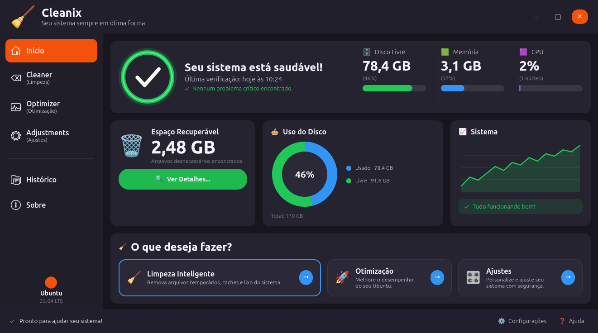

# Cleanix

Limpeza e otimização do sistema para Linux, com interface moderna em **GTK4**.

Inspirado no visual do CCleaner, o Cleanix reúne em uma única tela o estado de
saúde do sistema, o espaço recuperável, o uso do disco e atalhos para limpeza,
otimização e ajustes — tudo com gráficos desenhados em **Cairo** e dados reais
do sistema.



## Recursos

- Dados reais de disco, memória e CPU, atualizados em segundo plano.
- Anel de saúde baseado no espaço livre em disco (verde, amarelo ou vermelho).
- Rosca de uso do disco do sistema e painel **“Uso de CPU”** com o gráfico de
  linha das últimas amostras.
- Seção **Discos conectados** na tela inicial: lista discos físicos e partições
  (inclusive não montados/externos), agrupados por disco, com capacidade total,
  usado/livre, percentual e ponto de montagem quando disponível, além de botão
  **Atualizar**.
- **Saúde (SMART)** sob demanda por disco físico: verificação via `smartctl`
  (avaliação PASSOU/FALHOU/indisponível e atributos importantes), com senha de
  administrador quando necessário. Se o `smartmontools` não estiver instalado,
  o app orienta e oferece instalação com um clique (ou uso do app Discos).
- **Raio-X da máquina**: resumo rápido por tópicos (BIOS/sistema, hardware e
  programas instalados) com detalhes expansíveis, coleta sob demanda (com opção
  de detalhes completos via administrador), programas separados por APT, Snap
  e Flatpak (com busca) e **exportação de relatório completo em HTML** — com
  senha única para incluir também os detalhes completos de BIOS e hardware,
  tabelas pesquisáveis e layout pronto para impressão/PDF.
- Painel de memória RAM na tela inicial, com uso e capacidade total,
  disponível, cache e gráfico ao vivo, além de um atalho para liberar o cache.
- Varredura segura de cinco categorias:
  - Lixeira do sistema;
  - miniaturas de imagens;
  - cache dos navegadores (Chrome, Chromium, Firefox, Brave, Edge e Vivaldi);
  - arquivos temporários do usuário em `/tmp`;
  - cache de pacotes do APT (com senha de administrador na hora de limpar).
- Menu lateral em português, com uma entrada por ação e “Ajuda e Sobre” unificado.
- Ação principal **“Revisar e limpar”** no topo, com a lista de categorias
  somente leitura na tela inicial (a seleção acontece no diálogo).
- Interface em **português, inglês e espanhol**, com troca imediata em
  Configurações.
- Diálogo de detalhes com tamanho e número de arquivos por categoria.
- Confirmação explícita antes de remover, com aviso quando há navegadores
  selecionados.
- Relatório ao final da limpeza (bytes liberados, arquivos removidos e erros),
  com o Espaço Recuperável atualizado na hora e revarrido em seguida.
- Histórico persistente das limpezas em
  `~/.local/share/cleanix/history.json` (últimas 200 entradas).
- **Otimizador** com ações reais: limpeza do APT, journal vacuum, `fstrim`,
  liberação do cache da memória RAM em um diálogo próprio e gerenciador de
  aplicativos de inicialização.
- **Ajustes** com switches reais para animações do GNOME e limpeza automática
  de lixeira/temporários, aplicados via `gsettings`.
- **Configurações** com idioma da interface, "confirmar antes de limpar" e
  "guardar histórico".
- Ações administrativas usam `pkexec`, que abre a janela de senha do sistema.
- Log das ações em `~/.local/state/cleanix/cleanix.log`.

## Requisitos

- Python 3.10+
- GTK 4
- PyGObject (`python3-gi`)
- pycairo

No Ubuntu/Debian:

```bash
sudo apt install python3-gi python3-gi-cairo gir1.2-gtk-4.0 python3-cairo
```

Opcional (para verificação de **saúde SMART** dos discos): `smartmontools`
(`smartctl`). Se não estiver instalado, o Cleanix pode sugerir/instalar quando
você clicar em “Saúde (SMART)”.

## Como executar

```bash
python3 -m cleanix.main
```

### Instalar no menu de aplicativos

```bash
./install.sh
```

O script copia o ícone e o atalho para `~/.local/share` (sem root) e valida o
arquivo `.desktop`. Depois disso, basta procurar por **Cleanix** no menu do
Ubuntu.

## Como rodar os testes

```bash
python3 -m unittest discover -s tests -v
```

## Estrutura

- `cleanix/cleanixwindow.py` — tela inicial, menu, discos conectados e varredura.
- `cleanix/dialogs.py` — diálogos de limpeza, otimizador, ajustes, histórico,
  configurações e saúde SMART.
- `cleanix/scanner.py` — varredura e remoção segura.
- `cleanix/execution.py` — comandos locais e administrativos via `pkexec`.
- `cleanix/memory.py` — memória RAM e liberação do cache.
- `cleanix/systeminfo.py` — disco/memória/CPU, discos conectados e análise SMART.
- `cleanix/adjustments.py` — ajustes do GNOME via `gsettings`.
- `cleanix/charts.py` — gráficos Cairo.
- `cleanix/i18n.py` + `cleanix/locale/` — traduções e formatação por idioma.

## Idiomas

O Cleanix detecta o idioma do sistema (`LANG`/`LC_ALL`) e abre em português,
inglês ou espanhol. Em **Configurações → Idioma da interface** a troca é
imediata, sem reiniciar o app, e a escolha fica salva em
`~/.config/cleanix/config.json`.

Todos os textos da interface ficam em catálogos JSON planos:

- `cleanix/i18n.py` — camada de tradução (`t`, `tn`), números e datas por idioma;
- `cleanix/locale/pt_BR.json`, `en.json`, `es.json` — mesmas chaves nos três
  arquivos.

Para adicionar ou corrigir um texto, edite a mesma chave nos três catálogos.
Não há etapa de build: o app lê os JSON direto do código.

## Segurança

A limpeza do usuário é limitada a uma allowlist fechada: lixeira, miniaturas,
cache dos navegadores e arquivos temporários em `/tmp`. O cache do APT é limpo
pelo comando oficial `apt-get clean`, executado via `pkexec` depois da
confirmação e da senha de administrador.

- Links simbólicos nunca são seguidos e cada caminho é revalidado antes da
  remoção.
- As pastas-raiz das categorias nunca são removidas.
- Em `/tmp`, só saem arquivos do próprio usuário com mais de 10 minutos,
  ignorando arquivos abertos, diretórios usados como `cwd` e suas subárvores.
- Falhas em um arquivo não interrompem o restante; os erros são somados e
  exibidos no relatório.
- Se `$HOME` não for gravável, a limpeza é cancelada.
- Nada é apagado sem confirmação explícita.

## Estrutura

```
cleanix/
├── cleanix/
│   ├── __init__.py
│   ├── main.py            # entry point (Gtk.Application) e log
│   ├── cleanixwindow.py   # janela principal e integração
│   ├── dialogs.py         # avisos, confirmação, ações e histórico
│   ├── scanner.py         # varredura e limpeza segura (allowlist + APT)
│   ├── execution.py       # comandos locais e via pkexec
│   ├── memory.py          # cache da RAM (/proc/meminfo + drop_caches)
│   ├── systeminfo.py      # disco, memória, CPU e formatação pt-BR
│   ├── history.py         # histórico persistente
│   ├── autostart.py       # apps de inicialização (ler/ativar/desativar)
│   ├── settings.py        # preferências em ~/.config/cleanix/config.json
│   ├── charts.py          # widgets desenhados em Cairo
│   └── styles.css         # tema GTK4
├── data/
│   ├── br.cleanix.Cleanix.desktop  # atalho do menu de aplicativos
│   └── br.cleanix.Cleanix.svg      # ícone escalável
├── install.sh             # instala atalho e ícone em ~/.local/share
├── tests/                 # testes unittest
├── tools/
│   └── screenshot.py      # captura offscreen reproduzível
├── docs/                  # design e plano de implementação
├── mocup.png              # mockup de referência
└── preview_*.png          # capturas reais do app
```

Os arquivos `cleanix/ui.py`, `cleanix/safety.py` e `cleanix/utils.py` são
legado da versão GTK3, não são usados pelo aplicativo atual e não devem ser
reutilizados.

## Status

- [x] Dados reais do sistema (disco, RAM, CPU) e gráficos atualizáveis
- [x] Listagem de discos conectados/partições na tela inicial, com atualização
- [x] Verificação de saúde SMART dos discos (com instalação assistida do smartmontools)
- [x] Raio-X da máquina (BIOS, hardware, programas instalados e exportação HTML)
- [x] Limpeza real com confirmação, relatório e histórico
- [x] Cache do APT marcável no Cleaner, com senha na hora de limpar
- [x] Otimizador com ações reais (APT, journal, fstrim, RAM, Startup Apps)
- [x] Ajustes do sistema via gsettings
- [x] Página de Configurações com preferências persistentes
- [x] Atalho no menu de aplicativos com ícone próprio
- [ ] Ícones vetoriais próprios no lugar dos emojis (opcional)
- [ ] swappiness e governador de CPU (exigem root)
